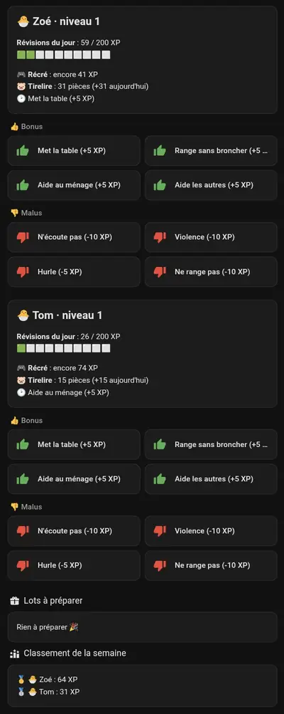

<p align="center"></p>

<h1 align="center">Révisions pour Home Assistant</h1>

<p align="center">
  <a href="https://hacs.xyz"></a>
  <a href="https://github.com/tchangy-studio/revisions-ha/releases"></a>
  
  <a href="LICENSE"></a>
</p>

La tirelire, les révisions du jour, la récré et les bonus / malus des enfants, directement dans Home Assistant.

🚧 Version 0.x : en construction.

<p align="center"></p>

## Révisions, c'est quoi ? (avant-première)

**Révisions** est une appli familiale pour réviser en jouant, de la **petite section au CM2**, en suivant les programmes de l'Éducation nationale.
Son dépôt n'est pas encore public : voici un avant-goût.

- **Des jeux courts lus à voix haute**, avec une explication à chaque erreur : lettres, sons et lecture, nombres, calcul mental,
  tables, opérations posées, fractions, heure, monnaie, mesures, conjugaison, homophones, anglais…
- **XP et niveaux** : on progresse en révisant, avec un plafond par jour pour ne pas y passer la soirée.
- **La récré** : des mini-jeux qui s'ouvrent quand l'objectif du jour est atteint.
- **Des pièces et une boutique** remplie par les parents : temps d'écran, petits jouets, tirage au sort…
- **Un espace parents** protégé par un code : joueurs, barème, boutique, et des **bonus / malus** du quotidien (« Met la table », « N'écoute pas »).
- **Tout reste à la maison** : un conteneur Docker sur le réseau local, pas de compte, pas d'abonnement, pas de publicité,
  et une version tablette qui marche même sans serveur.

Cette intégration est le pont entre Révisions et Home Assistant : suivre les enfants d'un coup d'œil, donner un bonus
depuis le tableau de bord ou un bouton physique, être prévenu quand un lot est acheté.

## Installation (Marketplace / HACS)

1. Dans Révisions : mets l'adresse IP de Home Assistant dans `HA_IPS` du fichier `revisions.conf`, puis `docker compose up -d`.
2. Dans Home Assistant : **Paramètres → Marketplace** (ou HACS) → ⋮ → **Dépôts personnalisés** →
   `https://github.com/tchangy-studio/revisions-ha`, catégorie **Intégration** → **Révisions** → installer, puis redémarre Home Assistant.
3. Paramètres → Appareils et services → Ajouter une intégration → **Révisions** :
   - l'adresse **directe** du serveur (IP et port, par ex. `http://192.168.1.20:8010`), pas une adresse qui passe par un proxy ;
   - le **jeton** : dans Révisions, espace parents → onglet 🏠 Home Assistant → Afficher / Copier.

## Sécurité

Révisions n'accepte Home Assistant que s'il a **la bonne adresse IP et le bon jeton** : un autre appareil de la maison ne peut ni lire
les données des enfants ni donner des points. Si le jeton change (bouton « Nouveau jeton » dans l'espace parents), Home Assistant
affiche une demande de réauthentification : il suffit de coller le nouveau. Les messages d'erreur disent ce qui manque
(jeton refusé, ou adresse IP absente de `HA_IPS`). Paramètres → Appareils et services → Révisions → ⋮ → **Reconfigurer** permet de
changer l'adresse ou le jeton.

## Mises à jour

Une nouvelle version apparaît dans **Paramètres → Mises à jour** (entité `update.revisions`) : installer, puis redémarrer Home Assistant.

## Ce que ça crée

Un appareil par enfant (les comptes de test sont ignorés) :

| Entité | Contenu |
|---|---|
| `sensor.revisions_<prénom>_pieces` | tirelire (pièces), avec en attributs XP, niveau, avatar, classe, récré, dernière action |
| `sensor.revisions_<prénom>_revisions_du_jour` | XP de révisions du jour (maximum et objectif de récré en attributs) |
| `sensor.revisions_<prénom>_recre` | `fermée`, `ouverte` ou `bonus` (minutes restantes en attribut) |
| `sensor.revisions_<prénom>_niveau` | niveau de progression |
| `button.revisions_<prénom>_<comportement>` | un bouton par comportement réglé dans l'espace parents (bonus ou malus) |

Et un appareil **Révisions** :

| Entité | Contenu |
|---|---|
| `sensor.revisions_achats_en_attente` | nombre de lots à préparer, liste détaillée et classement de la semaine en attributs |
| `button.revisions_lot_le_plus_ancien_donne` | marque le plus ancien achat comme donné |

Un enfant ou un comportement ajouté dans Révisions apparaît tout seul dans Home Assistant (en moins d'une minute) ;
un comportement supprimé rend son bouton indisponible.

## Être prévenu quand un enfant achète un lot

L'intégration envoie l'événement `revisions_nouvel_achat` (`enfant_nom`, `nom`, `ico`, `prix`, `id`). Exemple d'automatisation :

```yaml
triggers:
  - trigger: event
    event_type: revisions_nouvel_achat
actions:
  - action: notify.mobile_app_mon_telephone
    data:
      title: "🛍️ Révisions"
      message: "{{ trigger.event.data.enfant_nom }} a acheté {{ trigger.event.data.ico }} {{ trigger.event.data.nom }} : à préparer !"
```

## Tableau de bord

Les boutons s'utilisent comme n'importe quelle entité. Par exemple une tuile verte avec confirmation :

```yaml
type: tile
entity: button.revisions_zoe_met_la_table
color: green
tap_action:
  action: perform-action
  perform_action: button.press
  target:
    entity_id: button.revisions_zoe_met_la_table
  confirmation:
    text: "Zoé : Met la table ?"
```

## Un joueur supprimé

Quand un joueur est supprimé dans Révisions, ses entités deviennent indisponibles. Pour le retirer de Home Assistant :
Paramètres → Appareils et services → Révisions → l'appareil du joueur → ⋮ → **Supprimer**
(impossible tant que le joueur existe encore dans Révisions).

## Qui est derrière ?


**Tchangy Studio**, c'est un papa de quatre enfants qui bricole la domotique de la maison sur son temps libre.
Révisions est né pour eux. Avec quatre enfants, le temps manque : le code est écrit **en binôme avec Claude**, l'IA d'Anthropic,
et chaque version est relue et testée à la maison avant d'être publiée.

Une idée, un souci ? Ouvre une [issue](https://github.com/tchangy-studio/revisions-ha/issues).

## Licence

[MIT](LICENSE) : tu peux réutiliser, modifier et partager ce code, en gardant la mention de Tchangy Studio.
